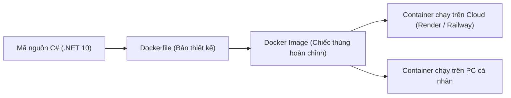

# RP30: HƯỚNG DẪN TOÀN TẬP ĐÓNG GÓI VÀ TRIỂN KHAI BACKEND VỚI DOCKER CONTAINER

> **Mã tài liệu:** `RP30`  
> **Dự án:** ieltsHSK — Nền tảng Luyện thi Đa ngôn ngữ IELTS & HSK 3.0  
> **Chủ đề:** Hướng dẫn từ vỡ lòng đến thực chiến triển khai Backend ASP.NET Core qua Docker Container  
> **Ngày lập:** 14/10/2026  
> **Mục tiêu:** Dành cho người chưa từng sử dụng Docker; hướng dẫn deploy lên Cloud miễn phí (Render.com / Railway) mà không cần cài đặt phần mềm nặng trên máy tính.

---

## 1. Docker Là Gì? (Giải Thích Dễ Hiểu Cho Người Mới)

Hãy tưởng tượng bạn chuyển nhà:
* **Cách truyền thống (như MonsterASP):** Bạn phải tự mang từng món đồ, tự đi thuê thợ cài đặt đúng phiên bản .NET 10, cấu hình IIS, chỉnh sửa quyền truy cập thư mục. Nếu máy chủ của họ thiếu 1 file DLL hay khác phiên bản, ứng dụng sẽ sập ngay lập tức.
* **Cách dùng Docker (Containerization):** Giống như bạn đóng gói toàn bộ ngôi nhà của mình vào một **"chiếc thùng Container kín"** — trong thùng đã có sẵn hệ điều hành Linux siêu nhẹ, có sẵn .NET 10 Runtime, có sẵn toàn bộ mã nguồn và thư viện.
  * Chiếc thùng này ném lên máy tính của bạn, hay ném lên Google Cloud, AWS, Render, Railway... nó đều **hoạt động y hệt nhau 100%**, không bao giờ gặp lỗi *"sao chạy ở máy tôi được mà lên server lại lỗi"*.



---

## 2. Điểm Tuyệt Vời: Bạn KHÔNG CẦN Cài Docker Vẫn Deploy Được!

Nhiều người nghĩ muốn dùng Docker là phải tải phần mềm **Docker Desktop** (nặng vài GB, ngốn RAM máy tính).  
👉 **Thực tế KHÔNG CẦN!**

Trong repository `ieltsHSK`, tôi đã tạo sẵn tệp [`Dockerfile`](../Dockerfile). Khi bạn đưa mã nguồn lên GitHub, các dịch vụ Cloud hiện đại như **Render.com** hoặc **Railway.app** sẽ:
1. Tự động đọc file `Dockerfile` của bạn.
2. Tự động biên dịch và tạo Container trên máy chủ siêu máy tính của họ (Cloud Build).
3. Tự động cấp phát đường dẫn HTTPS (ví dụ: `https://ieltshsk-api.onrender.com`) chạy 24/7 hoàn toàn miễn phí!

---

## 3. Hướng Dẫn Thực Chiến: Triển Khai Miễn Phí Lên Render.com (10 Phút)

**Render.com** là nền tảng Cloud hiện đại nhất hiện nay cho lập trình viên, có gói **Free Tier vĩnh viễn** hỗ trợ Docker cực tốt.

### Bước 1: Đăng ký tài khoản
1. Truy cập: [https://render.com](https://render.com)
2. Bấm **Sign Up** và chọn đăng nhập bằng tài khoản **GitHub**.

### Bước 2: Tạo Web Service mới
1. Tại màn hình Dashboard Render, nhấn nút **New +** ở góc trên bên phải ➔ chọn **Web Service**.
2. Chọn **Build and deploy from a Git repository**.
3. Kết nối với kho mã nguồn GitHub của bạn: chọn repository `ieltsHSK`.

### Bước 3: Cấu hình thông số triển khai
Điền các mục sau:
* **Name**: `ieltshsk-api` (hoặc tên bạn thích).
* **Region**: Chọn **Singapore** (Gần Việt Nam nhất, tốc độ phản hồi cực nhanh < 50ms).
* **Branch**: `main` (hoặc nhánh bạn đang push code).
* **Language / Environment**: Chọn **Docker** *(Render sẽ tự động dùng file `Dockerfile` ở thư mục gốc)*.
* **Instance Type**: Chọn gói **Free** ($0/month).

### Bước 4: Nhập Biến Môi Trường (Environment Variables)
Cuộn xuống phần **Environment Variables**, bấm **Add Environment Variable** và thêm các biến bảo mật từ thư mục `D:\project\ieltshsk_configs\appsettings.Production.json`:

| Key (Tên biến) | Value (Giá trị) | Chú thích |
| :--- | :--- | :--- |
| `ASPNETCORE_ENVIRONMENT` | `Production` | Chạy môi trường Production |
| `ConnectionStrings__DefaultConnection` | `Host=aws-0-ap-southeast-2.pooler.supabase.com;Port=5432;Database=postgres;Username=postgres.rzagqnuenzchhdiftwjr;Password=chienlop10roi;SSL Mode=Require;No Reset On Close=true;Maximum Pool Size=20` | Database Supabase Sydney |
| `Jwt__Key` | `7tsuVBK%*#iMAP@2EqRvd-y$03cbJ6a5=m+!wZlxpofGXT&Y` | Khóa ký JWT bảo mật |
| `Jwt__Issuer` | `IeltsHskApi` | Issuer chuẩn |
| `Jwt__Audience` | `IeltsHskFrontend` | Audience chuẩn |
| `Redis__ConnectionString` | `neat-oryx-215915.upstash.io:6379,password=gQAAAAAAA0trAAIgcDI0YTJlMjA0NzdmYWQ0MDgxYjI2MDM1NDNlNWRjNjljZg,ssl=True,abortConnect=False` | Upstash Redis |
| `Redis__Enabled` | `true` | Bật Redis cache |
| `Turnstile__SiteKey` | `0x4AAAAAAFTD3YvW1o0rj7NP` | Cloudflare Turnstile |
| `Turnstile__SecretKey` | `0x4AAAAAAFTD3W84IJUmpWO4ae4j54ELwsE` | Cloudflare Turnstile Secret |
| `Turnstile__Enabled` | `true` | Bật kiểm tra người thật |
| `ADMIN_INITIAL_PASSWORD` | `2W@pp87tij6dntyxuhrt` | Mật khẩu Admin của bạn |

### Bước 5: Bấm Deploy
* Nhấn nút **Create Web Service**.
* Render sẽ tự động kéo code, build Docker container và chạy. Quá trình này mất khoảng 2-3 phút.
* Khi thấy dòng chữ **`Your service is live 🎉`**, bạn sẽ nhận được một đường link dạng:  
  👉 `https://ieltshsk-api.onrender.com`

---

## 4. Cách Kết Nối Frontend Với Backend Mới

Sau khi bạn có URL Backend mới trên Render (ví dụ `https://ieltshsk-api.onrender.com`):

1. Mở tệp [`frontend/src/Frontend.App/wwwroot/appsettings.json`](../frontend/src/Frontend.App/wwwroot/appsettings.json).
2. Sửa đường dẫn API:
   ```json
   {
     "BackendApi": {
       "BaseUrl": "https://ieltshsk-api.onrender.com/"
     }
   }
   ```
3. Chạy script deploy Frontend:
   ```powershell
   .\scripts\deploy.ps1 -FrontendOnly
   ```
4. Xong! Toàn bộ hệ thống website của bạn từ nay chạy hoàn toàn trên Cloud hiện đại, ổn định và không còn phụ thuộc vào MonsterASP.

---

## 5. Dành Cho Ai Muốn Thử Nghiệm Docker Ngay Trên Máy Tính (Tùy Chọn)

Nếu sau này bạn muốn vọc vạch chạy Docker trực tiếp trên máy Windows của mình:

### 1. Cài đặt Docker Desktop:
* Tải tại: [https://www.docker.com/products/docker-desktop/](https://www.docker.com/products/docker-desktop/)
* Cài đặt và bật tính năng WSL 2 (Windows Subsystem for Linux).

### 2. Các lệnh cơ bản cần biết:

* **Lệnh 1: Đóng gói (Build) mã nguồn thành Docker Image:**
  ```powershell
  docker build -t ieltshsk-backend:v1 .
  ```

* **Lệnh 2: Chạy ứng dụng từ Image (Run Container):**
  ```powershell
  docker run -d -p 8080:8080 --name ieltshsk-api-container ieltshsk-backend:v1
  ```
  *(Khi này bạn mở trình duyệt gõ `http://localhost:8080/swagger` là thấy API hoạt động).*

* **Lệnh 3: Xem các container đang chạy:**
  ```powershell
  docker ps
  ```

* **Lệnh 4: Dừng container:**
  ```powershell
  docker stop ieltshsk-api-container
  ```

---

## 6. So Sánh: MonsterASP vs Docker trên Render.com

| Tiêu chí | MonsterASP (Gói Free) | Render.com (Docker Free) |
| :--- | :--- | :--- |
| **Độ ổn định** | Thường bị chuyển sang chế độ `Offline / Sleep` nếu không có truy cập. | Tự động thức dậy ngay khi có request (`Auto-spin down & wake up`). |
| **Cài đặt** | Phải upload qua FTP / File Manager từng file DLL. | Tự động build từ GitHub mỗi khi bạn push code mới (CI/CD). |
| **Quản lý biến môi trường** | Phải chèn thủ công vào `web.config` hoặc `appsettings.json`. | Có bảng giao diện Dashboard trực quan, bảo mật tuyệt đối. |
| **Hệ thống tệp** | Dễ bị sót file DLL cũ của lần build trước. | Mỗi lần build là một môi trường hoàn toàn mới, sạch 100%. |
| **Chi phí** | Miễn phí có thời hạn / cần gia hạn. | Miễn phí vĩnh viễn cho Web Service cá nhân. |

---

## 7. Tổng Kết

* File cấu hình Docker chuẩn hóa cho dự án đã được tạo sẵn tại: [`Dockerfile`](../Dockerfile) và [`.dockerignore`](../.dockerignore).
* Bạn hoàn toàn có thể thử nghiệm tạo tài khoản Render.com và trỏ vào GitHub bất cứ lúc nào bạn muốn chuyển đổi!
